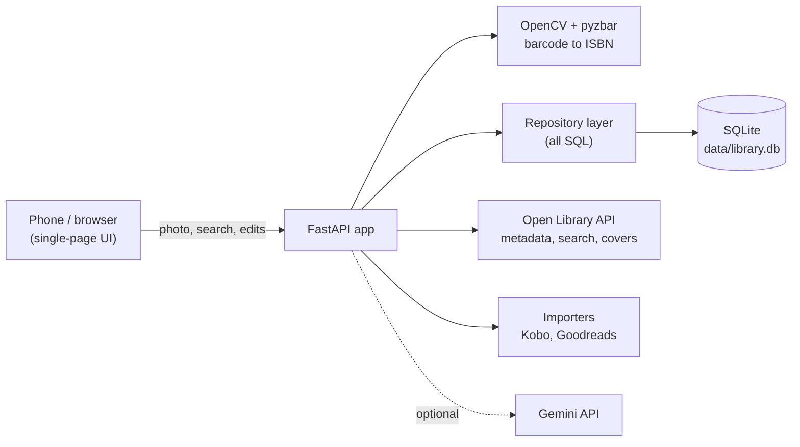
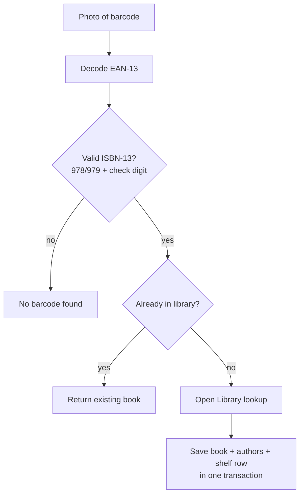

# Bookshelf

A self-hosted personal library. Point your phone at a book's barcode and it lands on your shelf with its cover, author and synopsis. Import your existing Kobo and Goodreads history, mark what you're reading or want to read, and keep everything in a single SQLite file on your own machine.

<!-- Add two or three phone screenshots here: the shelf grid, a book's detail dialog, the import preview. -->

## What it does

**Add books**
- **Scan:** take a photo of a barcode with your phone. The EAN-13 is decoded and checksum-validated, the book is looked up on [Open Library](https://openlibrary.org), and it is saved.
- **Batch import:** choose many photos from your gallery at once. They're shrunk, scanned two at a time, and summarised (added, already owned, failed) with a retry for failures.
- **Search:** one box for a title, an author or an ISBN (10 or 13 digits), with one-click add. Or type everything in by hand.
- **Duplicate protection:** the same ISBN is blocked; the same work or the same title and author asks before adding.

**Keep track**
- Shelves (Want to read, Reading, Read), 1 to 5 star ratings, notes, start and finish dates that follow your status changes.
- Owned versus wishlist, editable details, and a synopsis fetched from Open Library the first time you open a book.
- Accent-insensitive, Persian-aware search; sorting; filters; reading progress bars; a stats page (books finished per year, ratings, most-owned authors).

**Import your history** (preview first, nothing changes until you confirm)
- **Kobo:** reads your e-reader's `KoboReader.sqlite` read-only: books, reading progress, time spent, ratings, and your highlights and notes.
- **Goodreads:** reads the library export CSV: shelves, ratings, finish dates and reviews.
- Books you already have are only ever moved *forward* (Want, then Reading, then Read), and only blanks are filled in: your own ratings, dates and notes are never overwritten. Re-importing is safe and creates no duplicates.

**Covers and ISBNs, automatically**
- Covers come from the ISBN. Books without one (for example sideloaded e-books) are looked up by title and author in the background, which fills in the ISBN and cover.

**Optional: AI taste matching**
- "Will I like this?" gives a 0 to 100 score based on your own ratings.
- "Books like this" suggests up to five books. Every suggestion is checked against Open Library, so invented titles are dropped.
- Uses Google's Gemini API (free tier) and is off unless you add a key. Answers are saved and reused until your ratings change.

## How it works





## Quick start

You need Python 3.10 or newer and the zbar library for barcode decoding.

```bash
git clone https://github.com/salcxjo/bookshelf.git
cd bookshelf

python3 -m venv .venv && source .venv/bin/activate
sudo apt install libzbar0          # macOS: brew install zbar   (Windows: nothing extra)
pip install -e .                   # editable install, so the app finds web/ and data/ in the repo

uvicorn bookshelf.main:app --host 0.0.0.0 --port 8000
```

Open <http://localhost:8000>. On your phone (same Wi-Fi), open `http://<your-computer's-ip>:8000`. The first start creates `data/library.db` and applies every database migration. Interactive API docs are at `/docs`.

## Configuration

Copy `.env.example` to `.env` (it is gitignored). Everything is optional.

| Variable | Purpose |
|---|---|
| `BOOKSHELF_DB` | Path to the database file. Default: `data/library.db` in the repo. |
| `GEMINI_API_KEY` | Enables the AI features. A free key comes from [Google AI Studio](https://aistudio.google.com/apikey). |
| `GEMINI_MODEL` | Model name. Defaults to `gemini-flash-latest`; set it if you see "model not found", since names change often. |
| `OPENLIBRARY_CONTACT` | An e-mail or URL added to the User-Agent, as Open Library asks of API users. |

## Importing

**Kobo.** Connect the e-reader by USB, then choose `.kobo/KoboReader.sqlite` (a hidden folder) in **Import from Kobo**. The file is opened read-only and never modified. Or from a terminal:

```bash
python -m bookshelf.importers.kobo /path/to/KoboReader.sqlite            # preview only
python -m bookshelf.importers.kobo /path/to/KoboReader.sqlite --apply
```

**Goodreads.** On Goodreads, open My Books, then Import and export, and export your library. Choose the CSV in **Import from Goodreads**, or:

```bash
python -m bookshelf.importers.goodreads goodreads_library_export.csv            # preview only
python -m bookshelf.importers.goodreads goodreads_library_export.csv --apply
```

To-read books become wishlist books you don't own yet (a checkbox changes that). Only the main author of each book is imported.

## API

All endpoints return JSON. The full interactive reference is at `/docs`.

| Area | Endpoints |
|---|---|
| Books | `GET /books` (filter: `?status=`), `GET /books/{id}`, `POST /books`, `PATCH /books/{id}`, `DELETE /books/{id}` |
| Adding | `POST /scan` (photo upload), `GET /search?q=`, `GET /lookup/{isbn}` |
| Details | `GET /books/{id}/synopsis`, `GET /books/{id}/highlights` |
| Imports | `POST /import/kobo`, `POST /import/goodreads` (both preview by default; `?apply=true` to import) |
| Covers | `GET /covers/status`, `POST /covers/backfill` |
| Insights | `GET /stats`, `GET /ai/status`, `POST /books/{id}/ai/match`, `POST /books/{id}/ai/similar` |

## Project layout

```
src/bookshelf/
  main.py              FastAPI app and routes
  db/
    repo.py            every SQL query lives here
    migrate.py         tiny migration runner (PRAGMA user_version)
    migrations/        001_baseline.sql ... 008_isbn_lookup.sql
  vision/barcode.py    image bytes to a validated ISBN-13
  lookup/openlibrary.py  ISBN lookup, work search, synopses
  importers/           kobo.py, goodreads.py (plan, then apply)
  covers.py            fills in missing ISBNs and covers
  taste.py, llm.py     optional AI features
  isbn.py, textnorm.py small pure helpers
web/index.html         the whole front end: one file, no build step
data/                  your database (gitignored)
```

## Data model

SQLite, six tables: `books`, `authors`, `book_authors` (many to many), `shelf` (your status, rating, dates, notes and reading progress for a book), `highlights`, and `ai_results` (saved AI answers).

Schema changes are numbered SQL files applied automatically at startup. Each runs in its own transaction, so a failure rolls back cleanly, and the database file is copied to `library.db.pre-vN.bak` before anything is migrated.

## Technical notes

- **Barcode decoding** accepts only EAN-13 symbols that pass the ISBN-13 check digit and start with 978 or 979, which ignores the price add-on barcode and rejects misreads.
- **Importers plan, then apply.** A preview computes exactly what would change without writing; applying does it all in one transaction. Matching tries a previously stored id, then ISBN, then normalised title and author.
- **SQL features used:** transactions, upserts (`ON CONFLICT`), partial unique indexes, `CHECK` constraints, `json_group_array`, and a hand-rolled migration runner.
- **The front end is a single static file** built with `createElement` rather than `innerHTML`, so titles from external APIs can never inject markup.
- **AI answers are verified.** Suggested titles must exist on Open Library by a matching author before they are shown.

## Privacy and security

- Your data is a local SQLite file. Nothing is uploaded except the lookups below.
- Outbound requests: Open Library (ISBNs and titles, and cover images loaded by your browser) and, only if you set a key, Google's Gemini API, which receives titles, authors, star ratings and public synopses, never your notes or highlights. On the free tier Google may use what it receives to improve its products.
- There is **no login**. The server is meant for a home network. Don't expose it to the internet.

## Tests

```bash
pip install -e ".[dev]"
pytest
```

Current tests cover the barcode checksum and decoding and the Open Library client (with the network mocked). Tests for the repository layer, the importers and the API are the next thing to add.

## Acknowledgements

Book data and covers from [Open Library](https://openlibrary.org). Optional AI features use the [Gemini API](https://ai.google.dev).
